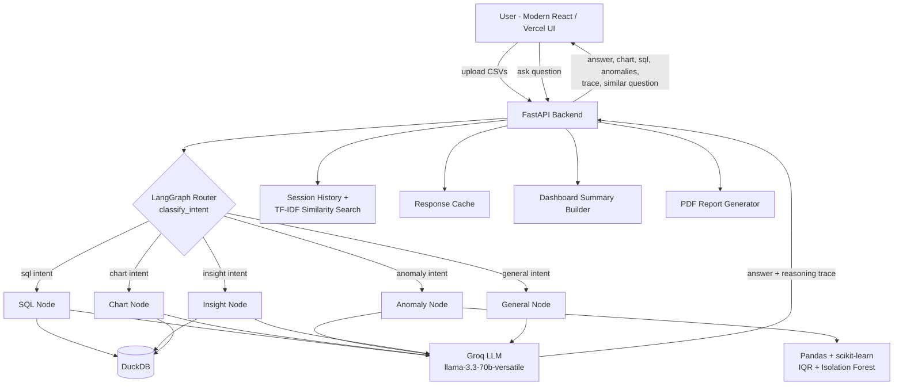

# AI Data Analyst

An AI-powered data analyst built for comprehensive business intelligence and exploratory data analysis. Upload one or more CSV files and ask questions about them in plain English — the app answers, generates interactive charts, writes SQL, detects statistical anomalies, and explains its reasoning at every step.

## Features

- **Natural language Q&A** over uploaded CSV data
- **Multi-file support** — upload several CSVs in one session and ask questions that span across them
- **Business insights & summaries** generated by an LLM
- **Interactive Chart generation** (bar, line, pie, scatter, etc.) via Plotly
- **SQL / Pandas generation** — displays the exact query executed against DuckDB to answer questions
- **Anomaly detection** with plain-language explanations, using IQR (per-category) + Isolation Forest
- **Agent reasoning trace** — every answer comes with an expandable step-by-step trace
- **Conversation memory** — session-scoped history maintained throughout
- **Executive Dashboard tab** — auto-aggregated KPIs (total revenue, average order value, total rows, anomaly count, dimensional breakdowns)
- **Proactive similar-question detection** — surfaces earlier Q&As if a new query is semantically similar (TF-IDF + cosine similarity)
- **PDF export** of the full analysis session
- **Response caching** per session/question
- **Vercel-ready Frontend** — modern React + Vite + Tailwind CSS interface optimized for edge deployment
- **Dockerized** — one command brings up both services

## Architecture



**Flow:** the user uploads CSVs, which are validated and loaded into a per-session DuckDB instance. Each question is classified by a LangGraph router into one of five intents (`sql`, `chart`, `anomaly`, `insight`, `general`), and routed to the matching node, which either queries DuckDB directly or runs Pandas/scikit-learn analysis before asking the Groq LLM to generate the final natural-language answer and reasoning trace. Every question is also checked against the session's own history via TF-IDF similarity before being answered.

## Tech Stack

| Layer | Technology |
|---|---|
| Frontend | React 18, Vite, Tailwind CSS, Lucide Icons (Vercel-ready) |
| Backend | FastAPI |
| Agent orchestration | LangGraph |
| Data engine | DuckDB (in-memory SQL) + Pandas |
| LLM | Groq API (`llama-3.3-70b-versatile`) |
| Charts | Plotly (interactive charts) |
| Anomaly detection | Per-category IQR + Isolation Forest (scikit-learn) |
| Semantic search | TF-IDF + cosine similarity (scikit-learn) |
| Containerization | Docker + docker-compose |
| Testing | pytest (15/15 unit & integration tests) |

---

## Deploying on Vercel

The frontend is built with React + Vite and comes with preconfigured `vercel.json` rewrites for single-click deployment on Vercel.

### Step 1: Deploy Backend (FastAPI)
Because the backend uses native C-extensions (DuckDB, scikit-learn, numpy, pandas), host the backend on a Python-friendly container platform:
- **Render / Railway / Fly.io / Docker**:
  1. Create a new Web Service pointing to your repository.
  2. Set Root Directory: `backend`
  3. Build Command: `pip install -r requirements.txt`
  4. Start Command: `uvicorn app.main:app --host 0.0.0.0 --port $PORT`
  5. Add Environment Variable:
     - `GROQ_API_KEY`: `your_groq_api_key_here`
  6. Copy your public backend URL (e.g., `https://ai-analyst-backend.onrender.com`).

### Step 2: Deploy Frontend on Vercel
1. Import your repository into **Vercel** (`https://vercel.com/new`).
2. In the project configuration:
   - **Framework Preset**: `Vite` (automatically detected)
   - **Root Directory**: `frontend`
3. In **Environment Variables**:
   - `VITE_BACKEND_URL`: `https://ai-analyst-backend.onrender.com` (your backend URL from Step 1)
4. Click **Deploy**!

> **Dynamic API Configuration:** The frontend also includes an in-app **API Settings** modal directly in the header, allowing you or any reviewer to point the frontend to any backend URL on the fly without redeploying.

---

## Local Setup & Development

### Prerequisites

- Python 3.12+
- Node.js 18+ and npm
- A free [Groq API key](https://console.groq.com)
- Docker & Docker Compose (optional)

### Option A — Docker Compose

```bash
# 1. Configure backend environment
cp backend/.env.example backend/.env
# Edit backend/.env and add your GROQ_API_KEY

# 2. Start services
docker-compose up --build
```

- Backend API: http://localhost:8000
- Frontend Web App: http://localhost:3000
- API Docs: http://localhost:8000/docs

### Option B — Manual Setup

**1. Start Backend:**
```bash
cd backend
python -m venv venv
# On Windows:
.\venv\Scripts\activate
# On macOS/Linux:
source venv/bin/activate

pip install -r requirements.txt
cp .env.example .env    # add GROQ_API_KEY
uvicorn app.main:app --reload --port 8000
```

**2. Start Frontend:**
```bash
cd frontend
npm install
npm run dev
```
Open http://localhost:3000 in your browser.

*(Note: The legacy Streamlit frontend is also preserved in `frontend_streamlit/` for reference and can be run via `streamlit run frontend_streamlit/app.py`)*.

---

## Sample Data

Sample datasets are located in `sample_data/`:
- `sample_data/sales_data.csv` — order items, dates, regions, products, customer names, quantities, unit prices, and revenue.
- `sample_data/regional_targets.csv` — target revenue metrics per region.

Upload both files in the sidebar to run multi-file queries such as:
*"Which regions are underperforming against their revenue targets?"*

## Example Questions to Try

- `Which region generated the highest revenue?`
- `Show monthly sales trends`
- `Which products are underperforming?`
- `What are the top 5 customers?`
- `Generate SQL for total revenue by category`
- `Detect anomalies in the dataset`
- `Which regions are underperforming against their revenue targets?` *(multi-file join)*

---

## Running Tests

From the project root:

```bash
pytest tests/
```

Test suite validates:
- Anomaly detection engine (IQR per-category and Isolation Forest)
- Chart engine (Plotly spec generation)
- DuckDB session isolation and query execution
- SQL query security and read-only enforcement

---

## Evaluation

An intent evaluation harness is provided in `eval/run_eval.py`:

```bash
python -m eval.run_eval
```

Measures classification accuracy across standard analytical question categories (`sql`, `chart`, `anomaly`, `insight`, `general`).

---

## Implementation Notes & Design Decisions

- **Anomaly detection is grouped per-category, not global** — IQR bounds are computed per `category` group so each product is evaluated against its respective peers rather than distorting bounds between inexpensive items and high-end hardware.
- **Derived columns are handled intelligently** — dependent metrics (e.g. `revenue = quantity * unit_price`) are automatically excluded from redundant anomaly flags when base features exist, while still permitting anomaly checks on standalone revenue datasets.
- **Single-threaded DuckDB safety** — `PRAGMA threads=1` avoids threading issues with memory-mapped allocators across different OS architectures.
- **Proactive session similarity matching** — TF-IDF and cosine similarity detect duplicate or near-duplicate queries within the current user session.
- **Vercel Edge Ready** — SPA routing rules and client-side Plotly rendering ensure zero SSR hydration issues and blazing-fast performance.
